 

  

 

### `> whoami`

I build software that people actually log into, click on and depend on — community platforms, moderation systems, point-of-sale tools and game mods. I care about the boring parts that make things trustworthy: input validation, rate limits, audit logs, and interfaces that feel finished.

Currently studying Computer Science (cyber security track) while shipping independent projects for clients and my own communities.

 

### `> ls ./projects`

<table>
  <tr>
    <td width="50%" valign="top">
      <h4>NEPX Roleplay Platform</h4>
      <code>React</code> <code>Vite</code> <code>Tailwind</code> <code>Vercel</code>
      
Website for a GTA V roleplay community with a Discord-integrated whitelist pipeline: timed quiz, applications, staff review panel, role sync and 2FA-gated staff access. Hardened against a 54-check attack suite.

    </td>
    <td width="50%" valign="top">
      <h4>Discord Moderation Suite</h4>
      <code>Python</code> <code>discord.py</code> <code>AutoMod</code>
      
Anti-scam and anti-raid bots for creator communities: join risk scoring, strike ladders, word-diff edit logs, persistent staff buttons, ticketing and daily digests.

    </td>
  </tr>
  <tr>
    <td width="50%" valign="top">
      <h4>tenzeroo_restro</h4>
      <code>FastAPI</code> <code>SQLite</code> <code>React</code> <code>Cloudflare Workers</code>
      
Full cafe POS: billing with VAT and Nepali calendar dates, kitchen displays, recipe-level inventory, payroll and reports. QR table ordering runs through a signed, server-priced edge worker so the till never touches the public internet.

    </td>
    <td width="50%" valign="top">
      <h4>TENZIN</h4>
      <code>Python</code> <code>Voice</code> <code>Local AI</code>
      
A local, voice-driven desktop agent for Windows — coding help, file and system control, and routines — designed to run on the machine it serves.

    </td>
  </tr>
</table>

 

### `> stack --list`

  
   
  

 

### `> git log --stats`

  
  

  

 

### `> contact`

Open to freelance work: web apps, Discord bots, FiveM resources and small business tools.
Reach me on Discord at **tenzero0**.

 

  <code>// build it properly, then ship it.</code>

